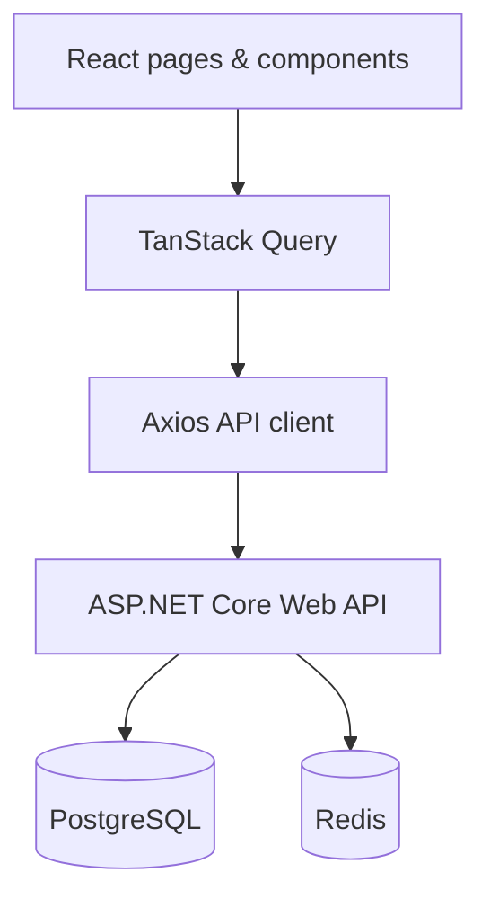

<div align="center">

# fomo-forum.


</div>


## О проекте

**fomo-forum.** — веб-форум с категориями, тематическими обсуждениями и линейными сообщениями. Здесь можно находить ответы на вопросы, участвовать в обсуждениях, сохранять интересные темы и взаимодействовать с сообществом.

Проект состоит из **двух независимых репозиториев**: этот репозиторий содержит клиентское приложение, а серверная часть разрабатывается отдельно на **ASP.NET Core, PostgreSQL и Redis**. Frontend общается с backend по HTTP API.

Интерфейс ориентирован на удобство чтения: компактные списки тем, понятная навигация и минимум визуального шума. Вдохновение — лаконичность современных приложений вроде ChatGPT, без копирования их фирменных элементов.

## Возможности

| Раздел | Что предусмотрено |
|:--|:--|
| **Обсуждения** | Лента новых и популярных тем, категории, закреплённые и закрытые темы |
| **Темы** | Первый пост и ответы в едином хронологическом потоке |
| **Поиск** | Поиск по заголовкам и сообщениям на русском и английском языках через backend |
| **Пользователи** | Регистрация, вход, публичные профили и личные настройки |
| **Взаимодействие** | Лайки, дизлайки, избранное, редактирование своих сообщений |
| **Модерация** | Жалобы, временные и бессрочные блокировки по роли, закрытие, закрепление и удаление тем/ответов |

## Технологии

| Технология | Назначение |
|:--|:--|
| **React + TypeScript** | Компоненты и строгая типизация |
| **Vite** | Разработка и production-сборка |
| **Tailwind CSS v4** | Стили и дизайн-токены |
| **React Router** | Клиентская маршрутизация |
| **Axios** | HTTP-клиент для backend API |
| **TanStack Query** | Получение, кэширование и обновление серверных данных |
| **React Hook Form + Zod** | Формы и валидация |
| **Lucide React** | Монохромные иконки |
| **ESLint** | Статическая проверка кода |
| **Vitest + Testing Library** | Планируемое тестирование компонентов и сценариев |

## Локальный запуск

### Требования

- Node.js актуальной LTS-версии, совместимой с используемым Vite;
- npm;
- Git;
- Для запросов к реальным данным — запущенный backend и его актуальный API-контракт.

### Установка

```bash
git clone <URL_ВАШЕГО_FRONTEND_РЕПОЗИТОРИЯ>
cd web-forum-frontend
npm install
```

### Переменные окружения

Скопируйте `.env.example` в `.env.local` и укажите адрес вашего локального backend. После любого изменения `.env*` перезапустите Vite: переменные читаются при запуске dev-сервера.

```dotenv
# Укажите подтверждённый адрес локального ASP.NET Core API
VITE_API_BASE_URL=<ваш URL API>
VITE_API_TIMEOUT_MS=10000
VITE_ENABLE_DEV_FIXTURES=false
```

Переменные с префиксом `VITE_` доступны в браузерной сборке. **Не храните в них JWT-секреты, пароли, ключи доступа и другие чувствительные данные.** Адрес API должен соответствовать фактически запущенному backend; также потребуется корректная настройка CORS на сервере.

### Запуск приложения

```bash
npm run dev
```

Vite выведет локальный адрес приложения в терминал (обычно `http://localhost:5173`).

### Проверки и сборка

```bash
npm run lint
npm run build
npm run preview
```

Тесты запускаются командой `npm run test` (watch mode) или `npm run test:run` (один запуск).

> Если шаблон Vite установил TypeScript 7 и npm сообщает о конфликте с `typescript-eslint` 8.x, используйте совместимую версию TypeScript, например 5.9.x, без `--force` и `--legacy-peer-deps`.

## Архитектура



Frontend отвечает за маршруты, отображение данных, формы и пользовательское взаимодействие. **Вся критичная проверка прав и бизнес-правил остаётся на backend**: скрытая кнопка не является механизмом безопасности.

Клиент не должен придумывать HTTP-маршруты, DTO или способ передачи refresh-токенов. Интеграция выполняется по реальной OpenAPI/Swagger-спецификации серверного репозитория.

Организация исходников строится вокруг страниц, переиспользуемых компонентов, API-клиента и отдельных функциональных областей. Существующая структура Vite сохраняется и развивается постепенно.
